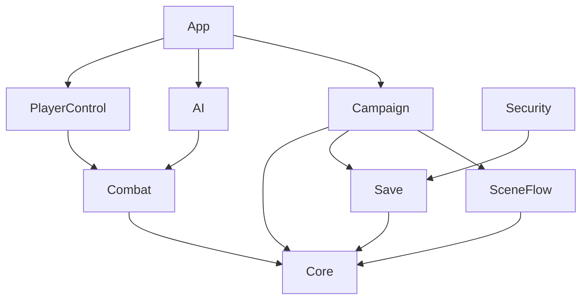

# Astra Syndicate: Fleet Wars: Architecture

Offline-first Unity 6 (6000.3, URP) project. All game code lives in `Assets/AstraSyndicate`, split into
modules (one assembly definition each). Modules talk through a typed **event bus** and **service interfaces**.
The modules are wired together in one place, `GameBootstrapper`.

## Modules

| Module (assembly) | Folder | Responsibility | May reference |
|---|---|---|---|
| `AstraSyndicate.Core` | `Scripts/Core` | Event bus, service registry, the gameplay events shared between modules, `Faction` | nothing |
| `AstraSyndicate.Save` | `Scripts/Save` | Save pipeline (serialize → protect → store), backup copies, the `ISaveDataProtector` hook | Core |
| `AstraSyndicate.Security` | `Scripts/Security` | Reference save encryption (AES-256 + HMAC) and its provider asset | Core, Save |
| `AstraSyndicate.SceneFlow` | `Scripts/SceneFlow` | Async scene loading behind a transition view | Core, UnityEngine.UI |
| `AstraSyndicate.Campaign` | `Scripts/Campaign` | Chapters (asset or JSON), progress and unlocks, the mission state machine and objectives, campaign navigation, mission-scene components | Core, Save, SceneFlow |
| `AstraSyndicate.Combat` | `Scripts/Combat` | Ships, flight physics, weapons and projectiles, damage, targeting, waypoints, pooling | Core |
| `AstraSyndicate.AI` | `Scripts/AI` | Enemy pilots (patrol, attack, retreat), wingmen, wave spawners | Core, Combat |
| `AstraSyndicate.PlayerControl` | `Scripts/PlayerControl` | Mouse-aim flight, input bindings, chase camera | Core, Combat, Unity.InputSystem |
| `AstraSyndicate.App` | `Scripts/App` | Startup (`GameBootstrapper`), `GameConfig`, cross-module glue (`MissionCombatBinder`), placeholder dev UI | every module above except Security |
| `AstraSyndicate.EditorTools` | `Editor` | Content generators, validation, builds (editor only) | anything |
| Tests | `Tests/EditMode`, `Tests/PlayMode` | Unit, integration and architecture tests | anything |



### Rules (enforced by `Tests/EditMode/ArchitectureTests.cs`)

1. **Campaign and the combat modules never reference each other.** Combat publishes facts (`UnitDestroyedEvent`,
   `WaypointReachedEvent`, `PlayerDefeatedEvent` in Core), and mission objectives subscribe to them.
2. **Only App sees every gameplay module, and nothing references App** (apart from editor tools and tests).
   Behaviour that needs two modules, such as "flight input only while a mission runs", belongs in App.
3. **App does not reference Security.** Save protectors are plugged in as assets through the Save hook, so the
   encryption can be replaced without code changes.
4. **Runtime code never uses `UnityEditor`.** Editor code goes in `Assets/AstraSyndicate/Editor`.
5. **A new module gets an entry in `ArchitectureTests` and in this table**, listing its allowed dependencies.

If an architecture test fails, fix the code (publish an event, add an interface) rather than the table,
unless the team agrees the rule should change.

## How the game starts

- `GameBootstrapper` (App) runs before the first scene loads, whichever scene that is, so any scene can be played
  directly in the editor. It does the following:
  1. loads `Resources/AstraSyndicate/GameConfig`;
  2. builds every service with constructor injection;
  3. registers the services in `Services` (Core).
- Plain C# classes receive their dependencies through their constructors. MonoBehaviours, which can't, resolve
  them from `Services` in `Awake`/`Start`.
- Registered services:

  | Service | What it gives you |
  |---|---|
  | `IEventBus` | The event bus |
  | `ISaveService` | Saving and loading |
  | `ICampaignRepository` | The loaded chapters and missions |
  | `IProgressService` | Completions, unlocks and records |
  | `IMissionStateManager` | The current mission's state, objectives and timer |
  | `ISceneLoader` | Scene loading |
  | `ICampaignFlow` | Campaign navigation: start, retry, next mission, back to menu |

- `GameConfig` holds the campaign catalog, the main menu scene, the transition fade time and the save protector.

## Mission flow

`MissionStateManager` (Campaign, plain C#) runs one mission at a time:

```
Idle ─► Briefing ─► Running ⇄ Paused ─► Completed | Failed ─► Idle
```

| State | Game time (`MissionRunner`) | Flight input (`MissionCombatBinder`) | Mission content (`MissionContentGroup`) |
|---|---|---|---|
| Briefing | frozen | off, cursor free | inactive |
| Running | runs | on, cursor locked (hold Alt to free it) | activated on launch |
| Paused | frozen | off | unchanged |
| Completed / Failed | frozen | off | unchanged |
| Idle (menus, transitions) | runs | — | — |

- **Ending a mission:** it completes when every required objective is done. It fails on `PlayerDefeatedEvent`
  (the flagship is destroyed) or when the time limit runs out.
- **Recording results:** `CampaignDirector` records the result through `IProgressService`, which saves it
  immediately.

## Events

All events are `readonly struct`s published on `IEventBus`. Publishing doesn't allocate, and each handler's
exceptions are caught separately so one bad handler can't break the others.

| Event | Module | Published by | Used by |
|---|---|---|---|
| `UnitDestroyedEvent` | Core | `Ship` when it dies | destroy objectives, sandbox HUD |
| `WaypointReachedEvent` | Core | `WaypointTrigger` (flagship only) | reach-waypoint objectives |
| `PlayerDefeatedEvent` | Core | `PlayerFlightController` when the flagship dies | `MissionStateManager` (fails the mission), sandbox |
| `MissionStateChangedEvent` | Campaign | `MissionStateManager` | `MissionRunner`, `MissionCombatBinder`, `MissionContentGroup`, `CampaignDirector`, HUD |
| `ObjectiveUpdatedEvent`, `MissionEndedEvent` | Campaign | `MissionStateManager` | `CampaignDirector` (records results), UI |
| `MissionUnlockedEvent`, `ChapterUnlockedEvent`, `ProgressChangedEvent`, `ProgressResetEvent` | Campaign | `ProgressService` | UI |
| `SaveCompletedEvent`, `SaveFailedEvent`, `SaveLoadFailedEvent` | Save | `SaveService` | main-menu save notice |
| `SceneLoadStartedEvent`, `SceneLoadCompletedEvent` | SceneFlow | `SceneLoader` | UI |
| `ShipDamagedEvent`, `ShipDestroyedEvent` | Combat | `Ship` | HUD, effects |
| `FleetOrderIssuedEvent` | Combat | `PlayerFlightController` | `WingmanBrain` |
| `WaveStartedEvent` | AI | `EnemyWaveSpawner` | sandbox HUD |

## For the UI team

The current screens are placeholders (IMGUI, in `Scripts/App/DevUI`). Nothing else depends on them, so each one
can be replaced on its own:

| Placeholder | Scene | Shows |
|---|---|---|
| `DevMainMenu` | MainMenu | Continue, chapter and mission select, progress reset, save-damage notice |
| `DevMissionHud` | mission scenes | Briefing, objectives, pause menu, results; F1 opens debug tools |
| `DevFlightHud` | combat scenes | Crosshair, target lock and lead marker, ship markers, hull, boost, speed, wingmen |
| `CombatSandboxController` | CombatSandbox | Wave and kill readout, pause and defeat screens |

- **Read** from the services above. For flight, read `PlayerFlightController` (aim point, locked target, lead
  point, `InputEnabled`), `Ship` (hull, faction, name) and `ShipMotor` (speed, throttle, boost charge).
- **Act** only through `ICampaignFlow` (start, retry or continue a mission, return to the menu),
  `IMissionStateManager` (`Launch`, `Pause`, `Resume`), `IProgressService.Reset` and `ISceneLoader` (scenes outside
  the campaign).
- **Listen** to the events above instead of polling. If something you need isn't published, ask for an event
  rather than reaching into gameplay internals.
- **Loading screen:** implement `ISceneTransitionView` and hand it to `SceneLoader` in `GameBootstrapper`.
- **Menus over gameplay** should set `PlayerFlightController.InputEnabled = false`, which also frees the cursor.

## For the save-encryption module

```
save object ─► JSON ─► ISaveDataProtector.Protect ─► file (.sav, previous copy kept as .bak)
file ─► ISaveDataProtector.TryUnprotect ─► JSON ─► save object   (on failure: try .bak, publish SaveLoadFailedEvent)
```

- **Contract:** implement `ISaveDataProtector` (Save module):
  - `Protect` and `TryUnprotect` must round-trip exactly.
  - `TryUnprotect` returns `false` (it never throws) for data that was tampered with, truncated or written with
    another key. The save service then recovers from the backup.
- **Plugging in:**
  1. Create an assembly that references `AstraSyndicate.Save`, like `Scripts/Security` does.
  2. Implement the protector and a `SaveProtectorProvider` subclass with `[CreateAssetMenu]`.
  3. Create the provider asset and assign it to **Save Protector** in `GameConfig`.

  No game code changes are needed.
- **Proving it:** in your test assembly, reference `AstraSyndicate.Tests.EditMode`, subclass
  `SaveProtectorContract` and return your protector from `CreateProtector()`. You get the same checks the
  reference implementation passes: round trips, no readable save contents, changed or truncated data rejected,
  and garbage rejected without throwing.
- **Reference implementation (active now):**
  - `AesHmacSaveProtector` writes `"ASV1" | 16-byte IV | AES-256-CBC ciphertext | HMAC-SHA256` (encrypt-then-MAC).
  - The key comes from `DeviceKey`: PBKDF2 over `SystemInfo.deviceUniqueIdentifier`. That stops save editing and
    copying saves between devices, but not a determined attacker who has the game binary. A platform keystore is
    the next step.
  - Never change `DeviceKey`'s inputs, or existing saves become unreadable.
- **Migration:** `AesSaveProtectorProvider` reads old unencrypted saves only in the editor and development builds,
  and re-saves them encrypted. When you replace the format, keep reading the previous one (or migrate it) so
  players keep their progress.
- **Files:** `Application.persistentDataPath/saves/campaign_progress.sav` (+ `.bak`). Tools ›
  Astra Syndicate › Save Data opens or deletes them.

## Content authoring

- **Chapters:**
  - Each chapter is a `ChapterConfig` asset in `Data/Campaign`, or a JSON file with the same schema. A JSON
    chapter replaces an asset chapter with the same id.
  - Every chapter is listed in `CampaignCatalog`.
  - Check content with Tools › Astra Syndicate › Validate Campaign. The same check also runs at startup.
- **Objectives:**
  - `destroy_enemies`: `targetCount`, plus an optional `targetId` that filters by unit tag.
  - `survive`: `durationSeconds`.
  - `reach_waypoint`: `targetId` = the `WaypointTrigger` id.
  - New types: subclass `ObjectiveBase` and register the type in `ObjectiveFactory`.
- **Mission scenes:**
  - Every mission scene has the shared stage (flagship, wingmen, chase camera, flight HUD) and a `Mission` object
    with these components:
    - `MissionSceneController`, whose fallback mission id is used when you press Play in the scene directly;
    - `DevMissionHud`;
    - `MissionCombatBinder`.
  - Put each mission's enemies and gates under a `MissionContentGroup` that lists its mission ids. That content
    stays inactive until one of those missions launches, so several missions can share a scene. For example, the
    Chapter 2 placeholder reuses `Ch01_M03`.
- **Ships and balance:**
  - Configs are ScriptableObjects in `Data/Combat` (`Ship_*`, `Weapon_*`, `AI_*`). Ship prefabs are in
    `Prefabs/Ships`.
  - For a fixed encounter, set the `EnemyWaveSpawner`'s Total Waves to 1.
- **Generators:** Tools › Astra Syndicate › Setup Sprint 1 Content creates anything missing.
  - It never overwrites existing assets or scenes.
  - The one exception: it rebuilds mission scenes still in their pre-combat placeholder state.

## Tests and builds

| What | Where | Covers |
|---|---|---|
| EditMode | `Tests/EditMode` | Event bus, saves, encryption contract, campaign loading and validation, progress, mission state and objectives, flight maths, ballistics, AI decisions, architecture rules |
| PlayMode | `Tests/PlayMode` | Campaign loop and Chapter 1 played through the real scenes, combat with real physics, combat sandbox smoke test |

- **In the editor:** Window › General › Test Runner.
- **From the command line** (close the editor first):

  ```
  Unity.exe -batchmode -nographics -projectPath <project> -runTests -testPlatform EditMode -testResults results.xml
  Unity.exe -batchmode -nographics -projectPath <project> -runTests -testPlatform PlayMode -testResults results.xml
  Unity.exe -batchmode -quit -projectPath <project> -executeMethod AstraSyndicate.EditorTools.SprintSetup.RunBatch
  Unity.exe -batchmode -quit -projectPath <project> -executeMethod AstraSyndicate.EditorTools.BuildTool.BuildWindowsBatch
  ```

- **Windows player:** Tools › Astra Syndicate › Build › Windows Player writes `Builds/Windows/` (ignored by git).
